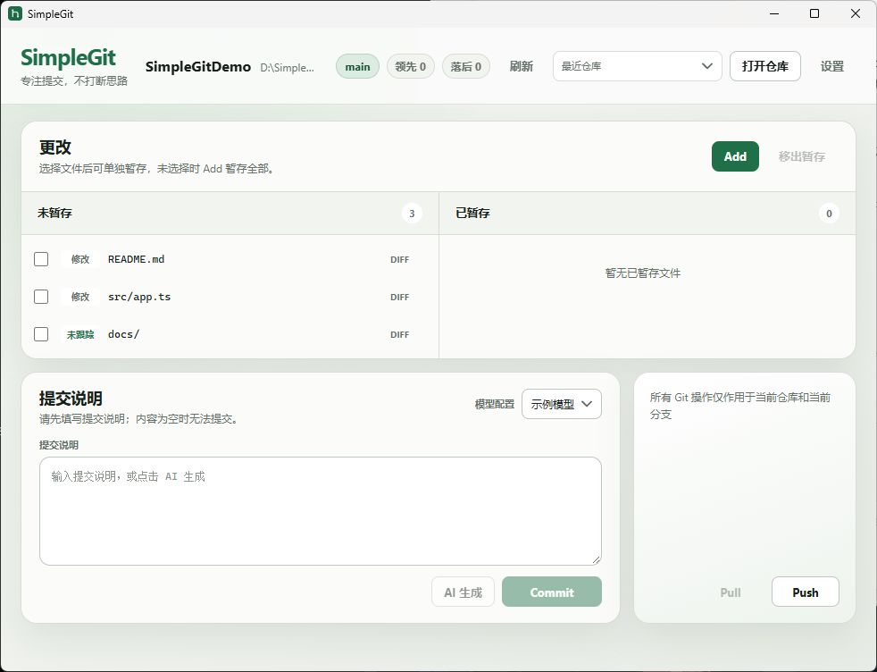

# SimpleGit

[MIT 许可证](LICENSE)

SimpleGit 是一款面向个人使用的轻量级 Git 桌面客户端。它把日常提交集中在单页工作流里：查看更改、选择性暂存、生成提交说明、提交，以及 Pull/Push。



## 功能

- 打开本地已有 Git 仓库，并快速切换最近仓库。
- 查看当前分支、upstream、ahead/behind 和文件级 diff。
- 暂存全部更改，或仅暂存勾选文件；支持取消暂存。
- 使用多个 OpenAI Chat Completions 兼容模型配置生成提交说明。
- 提供一套全局可编辑提交规则，默认使用中文 Conventional Commits。
- 提交说明为空时阻止提交；提交说明只能通过“AI 生成”按钮单独生成。
- Pull 仅允许 fast-forward；Push 不提供 force。
- Commit、Pull、Push 和 AI 生成均支持进行中取消；Windows 会终止 Git hook 子进程树。
- Windows 下 Git、诊断和进程树终止均使用隐藏控制台方式启动，不会在设置或 diff 操作时弹出黑窗口。
- API Key 存入 Windows Credential Manager；macOS 使用 Keychain。

## 不包含

- Clone、Init 或新建仓库。
- 多仓库标签页、多窗口并行。
- 分支切换、Merge、Rebase、Cherry-pick。
- Stash、冲突解决编辑器、逐行暂存。
- 历史图、Force push、Submodule、Git LFS。
- 多套提交规则。

## 环境要求

- Node.js 24+
- npm 11+
- Rust stable
- Windows：Visual Studio 2022 Build Tools，包含 C++ 和 Windows SDK
- macOS 预留：Xcode Command Line Tools
- 系统 Git 2.28+

确认 Rust 在 PATH 中：

```powershell
cargo --version
```

如果使用 rustup 默认安装但当前终端找不到 Cargo，将 `%USERPROFILE%\.cargo\bin` 加入 PATH。

## 安装依赖

```powershell
npm install
```

Cargo 依赖会在第一次测试或构建时自动下载。

## 使用

1. 点击右上角“打开仓库”，选择已有 Git 仓库。
2. 在“未暂存”中勾选文件，再点击 Add；不勾选时 Add 暂存全部更改。
3. 在“已暂存”中确认本次提交内容。
4. 手工输入提交说明，或点击“AI 生成”根据已暂存 diff 生成。
5. 检查提交说明，再点击 Commit 完成提交。
6. 使用 Pull 或 Push 同步当前分支。

### 模型配置

1. 打开“设置”并点击“新增模型”。
2. 填写配置名称、Base URL、Model ID 和可选 API Key。
3. 点击“保存模型”，再点击“测试连接”。
4. 在提交区切换当前模型。

Base URL 可以填写服务根地址，例如 `https://api.example.com/v1`。应用会自动追加 `/chat/completions`；已包含该路径的地址不会重复追加。无需鉴权的本地模型可以留空 API Key。

### 提交规则

所有模型共用一套规则。规则作为附加约束发送给模型，固定的安全指令仍由应用维护。规则留空时使用内置中文 Conventional Commits 规范。

### 密钥与设置

- 普通设置：`%APPDATA%\com.simplegit.desktop\settings.json`
- 系统密钥：Windows Credential Manager，服务名 `com.simplegit.desktop`
- macOS 设置目录：`~/Library/Application Support/com.simplegit.desktop/`

已保存的 API Key 不会返回 WebView，也不会写入设置 JSON。

## 数据与隐私

SimpleGit 不内置遥测或分析服务。打开仓库、查看状态、暂存和提交均在本地完成。

只有用户主动点击“AI 生成”时，应用才会向所选模型配置的 Base URL 发送以下内容：

- 当前分支名称。
- 最近 8 条提交标题。
- 当前已暂存 diff。
- 全局提交规则和固定生成指令。

diff 可能包含源码、配置、凭据或业务数据。请只配置可信模型服务，并在生成前确认暂存内容不含敏感信息。使用远程模型服务时，这些数据受对应服务商的隐私政策约束。

## 开发

```powershell
npm run tauri dev
```

仅运行前端测试：

```powershell
npm test
```

运行 Rust 测试：

```powershell
cargo test --manifest-path src-tauri\Cargo.toml
```

## 验证与打包

```powershell
npm test
npm run build
cargo fmt --manifest-path src-tauri\Cargo.toml --check
cargo clippy --manifest-path src-tauri\Cargo.toml --all-targets -- -D warnings
cargo test --manifest-path src-tauri\Cargo.toml
npm run tauri build
```

Windows 平台配置当前生成 MSI：

```text
src-tauri\target\release\bundle\msi\SimpleGit_0.1.0_x64_en-US.msi
```

macOS 安装包需在 macOS 主机上使用同一命令构建验证。

### GitHub Release

推送 `v*` 标签后，GitHub Actions 会依次执行测试、Rust 静态检查、Windows MSI 构建，并创建附带 MSI 和 SHA-256 文件的草稿 Release。

```powershell
git tag -a v0.1.0 -m "SimpleGit v0.1.0"
git push origin main
git push origin v0.1.0
```

标签版本必须与 `package.json`、`src-tauri/Cargo.toml` 和 `src-tauri/tauri.conf.json` 中的版本一致。构建成功后检查草稿 Release 中的安装包和校验文件，再手动发布。

## 项目结构

```text
src/                     React 单页界面、状态协调和 Tauri API 客户端
src/components/          文件区、diff、提交区、同步栏和设置弹窗
src-tauri/src/git/       状态解析、Git runner、工作区、同步和取消
src-tauri/src/settings/  配置持久化和系统凭据存储
src-tauri/src/ai/        提示词组装与 OpenAI 兼容客户端
docs/                    项目文档、设计规格、实施计划、验证记录和截图
```

## 安全边界

- Git 命令使用参数数组，不拼接 shell 字符串。
- 提交说明通过 stdin 传给 `git commit -F -`。
- Pull 始终使用 `--ff-only`。
- 不自动 stash、merge、rebase 或绕过 Git hook。
- 不提供 force push。
- Git 错误中的 URL 凭据会遮蔽后再展示。

## 项目文档

- [文档入口](docs/README.md)：按使用、架构、开发和维护场景组织。
- [架构说明](docs/architecture.md)：系统边界、核心数据流和安全不变量。
- [命令协议](docs/api.md)：Tauri 命令、参数、返回值和稳定错误码。
- [开发指南](docs/development.md)：常用命令、测试分层和典型扩展路径。
- [维护指南](docs/maintenance.md)：文档同步责任与提交前检查清单。
- [验证记录](docs/manual-test.md)：最近一次 Windows 构建、自动化和真实烟测证据。
- [设计规格](docs/superpowers/specs/2026-11-15-simplegit-design.md)：首版产品与技术设计依据。

项目文档以当前源码和配置为事实来源。行为发生变化时，应在同一改动中更新对应文档；设计与实施计划用于追溯决策，不代表未经验证的当前状态。

## 许可证

SimpleGit 使用 [MIT 许可证](LICENSE)。第三方依赖仍分别适用其各自许可证；分发安装包时需同时保留相关许可证和声明。

安全问题请遵循 [SECURITY.md](SECURITY.md)，不要通过公开 Issue 披露未修复漏洞。
