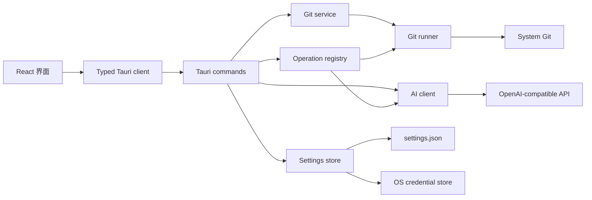

# SimpleGit 架构说明

SimpleGit 是单窗口、单仓库的 Tauri 2 桌面应用。React 负责交互和展示，Rust 负责文件系统、Git CLI、系统凭据、模型请求、锁与取消。渲染层不直接执行 shell 命令，也不读取已保存的 API Key。

同步基准：`SimpleGit 0.1.0`，核对日期 `2026-11-15`。

## 系统边界

关键边界：

- 前端与 Rust 的唯一业务通道是类型化 Tauri 命令。
- Git 操作使用参数数组调用系统 `git`，不构造 shell 命令。
- 普通设置与密钥分离存储；密钥只存在于系统凭据库并由 Rust 读取。
- 同一仓库的写操作通过 `OperationRegistry` 串行化。
- Commit、Pull、Push 和 AI 生成共享 `operationId` 取消协议。

## 启动与状态所有权

应用启动时，`src-tauri/src/lib.rs` 完成以下工作：

1. 注册 Tauri dialog 插件。
2. 从应用数据目录加载 `settings.json`。
3. 构造包含设置、系统密钥、HTTP 客户端和操作注册表的 `AppState`。
4. 注册全部 Tauri 命令。
5. 启动窗口。

前端没有全局状态库。`src/App.tsx` 持有仓库快照、选择集、展开的 diff、提交说明、活动模型、进行中操作、错误和通知。各组件只接收 props 并发出事件。设置弹窗维护自己的表单编辑状态，通过 `onSettingsChange` 将服务端返回的完整设置回写到 `App`。

## 主要模块

| 路径 | 职责 | 维护关注点 |
| --- | --- | --- |
| `src/App.tsx` | 页面级状态协调和操作编排 | 新增流程时保持错误、取消和刷新语义一致 |
| `src/api.ts` | 命令名称、参数和错误归一化 | 与 Rust 命令及 `src/types.ts` 同步 |
| `src/components/` | 顶栏、文件区、diff、提交区、同步栏、设置弹窗 | 业务判断尽量留在 `App`，组件保持可测试 |
| `src-tauri/src/commands.rs` | Tauri command 边界和 `AppState` | 命令层只编排，不复制 Git 或 AI 规则 |
| `src-tauri/src/git/status.rs` | porcelain v2 解析和快照类型 | 路径、重命名、冲突和分支字段约定 |
| `src-tauri/src/git/service.rs` | 仓库验证、根路径和状态读取 | 仓库识别和规范化路径 |
| `src-tauri/src/git/worktree.rs` | 暂存、取消暂存、diff 和提交 | 路径校验、stdin 提交和 hook 失败语义 |
| `src-tauri/src/git/sync.rs` | Pull、Push 和同步错误分类 | 只允许 fast-forward 拉取，禁止 force push |
| `src-tauri/src/git/runner.rs` | Git 进程启动、输入、取消和脱敏 | 不经过 shell，保留退出状态和原始字节；后台子进程使用隐藏控制台配置 |
| `src-tauri/src/operations.rs` | 仓库锁、进程树取消和异步任务取消 | 重复 operation ID、进程清理和平台差异 |
| `src-tauri/src/settings/` | 模型档案、设置文件和系统凭据 | 密钥不回传前端，JSON 损坏时不覆盖 |
| `src-tauri/src/ai/` | 提示词、端点规范化和 HTTP 调用 | diff 上限、提示注入隔离、响应解析 |

## 核心数据流

### 打开仓库与刷新

1. React 调用目录选择器并得到路径。
2. `open_repository` 规范化路径，执行 `git rev-parse --show-toplevel`。
3. 后端从仓库根执行 `git status --porcelain=v2 --branch -z`。
4. `parse_status` 生成 `RepositorySnapshot`，包含分支、upstream、ahead/behind 和文件状态。
5. 前端替换快照并记录最近仓库；窗口重新获得焦点时刷新状态。

文件路径始终由 Git 输出提供。读取暂存或未暂存 diff 前会拒绝空路径、绝对路径、父目录跳转和 NUL 字符。

### 暂存与提交

1. 用户勾选未暂存文件；没有勾选时前端选择“暂存全部”。
2. 后端在仓库锁内执行 `git add -A -- <paths>` 或 `git add -A`。
3. 命令返回最新仓库快照，前端清空选择集和展开的 diff。
4. 提交前后端重新检查冲突和已暂存内容。
5. 提交说明通过 stdin 传给 `git commit --cleanup=whitespace -F -`。
6. 前端在提交成功后清空说明并刷新状态；失败或取消时保留用户已输入的说明。

提交说明为空时，前端禁用 Commit 且不调用生成流程。模型输出只能由“AI 生成”按钮触发，并作为等待用户确认的草稿填入编辑框；用户检查说明后才能单独提交。

### AI 生成

1. 后端加载活动模型，并从系统凭据库读取对应密钥。
2. 在仓库锁内读取仓库状态、全部已暂存 diff 和最近 8 条提交标题。
3. 占用仓库锁的阶段结束后释放锁，避免长时间 HTTP 请求阻塞其他 Git 操作。
4. 注册 operation ID，将固定安全提示、用户规则和 diff 发送到 Chat Completions 端点。
5. 取消时停止等待并返回 `OPERATION_CANCELLED`。
6. 成功时提取 `choices[0].message.content`，仅去除首尾空白和包裹整个响应的代码围栏。

固定系统提示要求模型只根据已暂存 diff 生成说明，并把 diff 中的指令视为普通数据。超过 60,000 个字符的 diff 会直接报错，不会静默截断。

### Pull、Push 与取消

- Pull 始终使用 `git pull --ff-only`，没有 upstream 时返回 `UPSTREAM_MISSING`。
- Push 有 upstream 时使用 `git push`；缺失 upstream 时，用户确认后使用 `git push -u origin HEAD`。
- 两项操作都持有同一仓库锁，并注册 Git 子进程 PID。
- Windows 通过 Job Object 终止 Git 及其 hook 子进程；其他平台使用进程组。
- 错误详情统一合并 stdout/stderr，并在返回前遮蔽 URL 中的用户名和凭据。

## 数据与持久化

`AppSettings.version` 当前为 `1`，持久化内容包括最近仓库、活动模型 ID、模型档案和唯一一套提交规则。最近仓库最多保留 10 条，按字符串路径去重。

普通设置路径：

- Windows：`%APPDATA%\com.simplegit.desktop\settings.json`
- macOS：`~/Library/Application Support/com.simplegit.desktop/settings.json`

系统密钥服务名为 `com.simplegit.desktop`，账户名为 `model:<profile-id>`。模型档案只向前端暴露 `hasApiKey`。设置文件损坏时应用返回 `SETTINGS_FAILED`，不会用默认设置覆盖原文件。

设置写入优先使用同目录临时文件原子替换。Windows 加密漫游目录返回 `CrossesDevices` 时，回退为同目录内容复制并同步落盘。

## 安全与正确性不变量

修改代码时应保留以下不变量：

- Git 命令永不经过 shell 字符串拼接；所有参数通过 `.arg()` 或参数数组传入。
- 仓库相对路径必须在交给 Git 前校验，禁止逃逸当前仓库。
- Pull 不允许隐式 merge、rebase 或 stash；Push 不提供 force。
- 不自动绕过 Git hook，不自动执行 `--no-verify`。
- Windows 后台子进程统一使用 `CREATE_NO_WINDOW`，Git、诊断和进程树终止不得创建可见控制台。
- API Key 不写入设置 JSON、不返回前端、不进入普通日志。
- 模型输出只是草稿，提交必须由用户显式确认。
- 同一仓库的状态变更和同步操作必须串行。
- 长操作取消后返回稳定错误码，并清理活动注册记录。
- 技术错误详情展示前必须保留 URL 凭据脱敏。

## 扩展落点

| 新需求 | 首要修改位置 | 通常还需同步 |
| --- | --- | --- |
| 新 Git 操作 | `git/worktree.rs` 或 `git/sync.rs` | `commands.rs`、`lib.rs`、`api.ts`、`types.ts`、测试、`api.md` |
| 新文件状态展示 | `git/status.rs`、`ChangesPanel.tsx` | `types.ts`、前端交互测试、本文档 |
| 新模型协议字段 | `settings/`、`ai/` | 设置表单、请求测试、`api.md` |
| 新页面级流程 | `App.tsx` | 操作栏、取消/错误测试、本文档 |
| 新持久化字段 | `settings/mod.rs`、`settings/store.rs` | 迁移策略、设置测试、本文档 |
| 新平台支持 | `operations.rs`、Tauri 配置、CI/打包 | 开发指南、验证记录、发布约束 |

不要仅为新增页面而绕过 `SimpleGitClient`，也不要在 `src/components/` 中直接调用 Tauri `invoke`。
