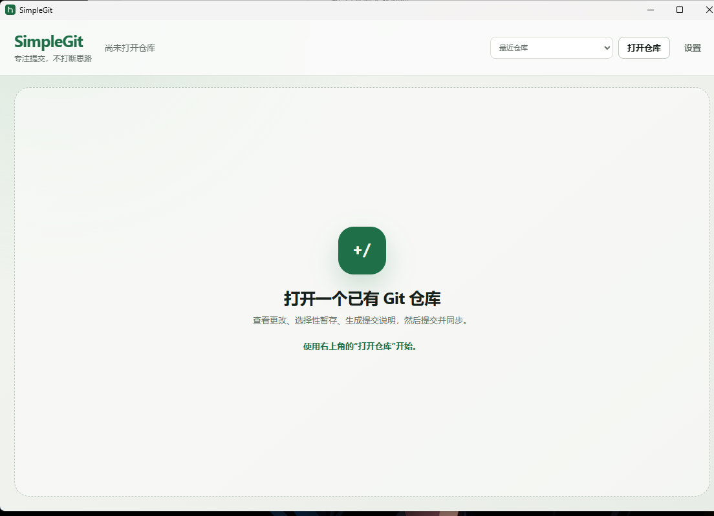
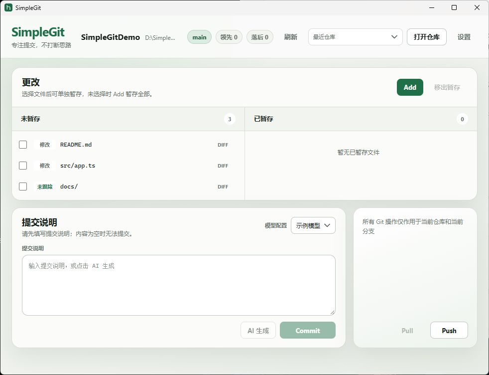
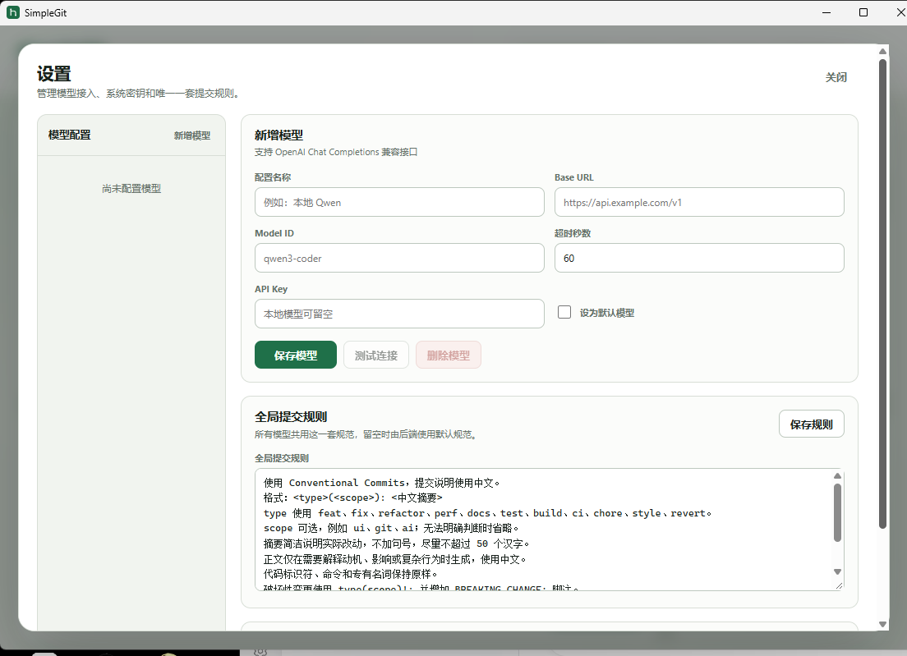

# SimpleGit 验证记录

验证日期：2026-11-15

## 环境

- Windows 11 x64
- Node.js 24.19.0
- npm 11.17.0
- Rust 1.100.0
- Git 2.52.0.windows.1
- Visual Studio 2022 Build Tools 17.14
- Tauri 2.12.5

## 自动化验证

### 前端

```powershell
npm test
```

结果：

```text
Test Files  3 passed (3)
Tests       23 passed (23)
```

覆盖主页面交互、错误保留、命令契约、模型配置、密钥输入语义和未保存修改确认。

```powershell
npm run build
```

结果：TypeScript 检查和 Vite 生产构建通过。

### Rust

```powershell
cargo fmt --manifest-path src-tauri\Cargo.toml --check
cargo clippy --manifest-path src-tauri\Cargo.toml --all-targets -- -D warnings
cargo test --manifest-path src-tauri\Cargo.toml
```

结果：

- 格式检查通过。
- Clippy 无警告。
- 48 个 Rust 测试通过。

测试覆盖：

- porcelain v2 分支、文件、重命名和冲突解析。
- 选择性暂存、全部暂存、取消暂存和 unborn branch。
- stdin 多行提交说明。
- pre-commit/pre-push hook 失败与取消。
- 本地 bare remote 的 Push、Pull、分叉和非快进。
- 同仓库操作串行化。
- Windows Credential Manager 真实读写和清理。
- AppData 加密漫游目录下的设置文件写入。
- Windows 后台子进程使用 `CREATE_NO_WINDOW`，避免控制台窗口。
- OpenAI 兼容请求、鉴权、超时、大 diff 和异常响应。

### Windows 安装包

```powershell
npm run tauri build
```

结果：

```text
Finished 1 bundle at:
src-tauri\target\release\bundle\msi\SimpleGit_0.1.0_x64_en-US.msi
```

MSI 大小约 4.29 MiB。

## 真实应用烟测

### 空状态

release 程序启动成功，窗口标题为 `SimpleGit`。
限制性 CSP 下 WebView 页面和 Tauri 命令均可正常加载。



### 本地仓库

通过最近仓库打开一个虚构测试仓库。

- 正确显示分支 `main`。
- 正确显示 ahead/behind。
- 正确列出 2 个修改文件和 1 个未跟踪目录。
- 提交说明、模型切换、Pull 和 Push 控件均按 repository 状态启用。



公开截图使用虚构仓库和示例模型，不包含个人目录、私有仓库内容或真实 API 配置。

### 设置

设置弹窗成功显示模型列表、档案表单、全局提交规则和诊断区域。



### 烟测中发现并修复的问题

首次打开仓库时，Windows 加密 AppData 中的原子替换返回 `CrossesDevices`。已增加同目录内容复制回退，并添加真实 AppData 写入测试。修复后再次打开仓库，最近仓库成功保存，界面无错误提示。

同时修正了 Windows canonical path 的 `\\?\` 前缀显示。

用户反馈打开设置和仓库 diff 操作时反复出现黑色控制台窗口。根因是发布版主程序使用 `windows_subsystem = "windows"`，而 Git 和 `taskkill` 子进程未设置 `CREATE_NO_WINDOW`；短进程获得焦点后还可能触发窗口 focus 刷新，放大为连续弹窗。修复后统一通过 `src-tauri/src/child_process.rs` 配置后台子进程，并增加 Windows 启动参数回归测试。

release 版 UI 烟测打开本地测试仓库、展开并收起真实 diff、连续三次开关设置以及最小化/恢复窗口，期间监听到的可见控制台类窗口数量为 0。

## 尚未验证

- macOS 实机启动、Keychain 和打包。
- 真实云端模型服务的在线推理计费流程。
- 真实带认证 remote 的 Push/Pull；当前使用本地 bare remote 验证 Git 语义。
- 安装 MSI 后的升级、卸载和签名行为。

这些项目不影响当前 Windows 开发构建，但正式分发前应在对应环境补充验证。
